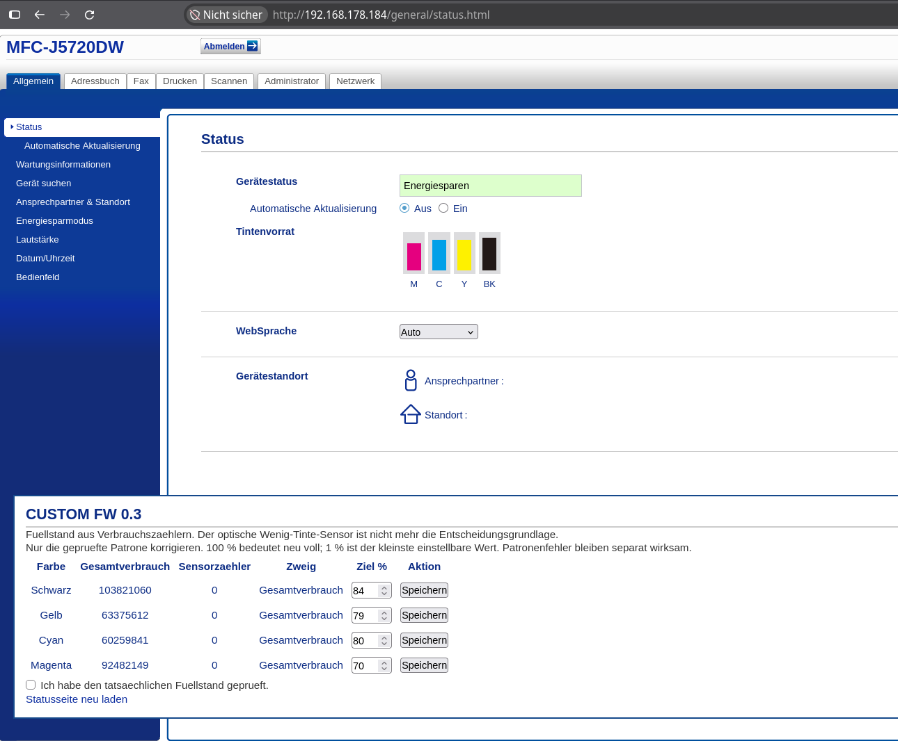

# Brother Ink Control

Experimental firmware customization for the **Brother MFC-J5720DW with LC223
cartridges**, adding an English web interface for calibrating actual ink
consumption counters.

A visibly full cartridge can still enter the printer's low-ink state. This
project adds per-color calibration from **1% to 100%**, updates the native
consumption/sensor counters, and derives low-ink detection from consumption.
The raw optical sensor sample remains available for diagnostics.

**This is a model- and firmware-specific research implementation.** The current
bindings target the original `R2401191337:F58C` image and `SPEC=0003`. Each other
model or firmware revision needs its own reverse engineering and validation.

## Status and scope

| Item | Status |
| --- | --- |
| Model / cartridge | MFC-J5720DW / LC223 |
| Original image | `LZ5014_R.djf`, exact hash below |
| CPU / ABI | ARMv5TE, Thumb-1, big-endian BE32 |
| Web interface | Native status page, authenticated POST, one color per save  |
| Storage | Real total and sensor counters; selected native state mirrors |
| Low-ink policy | Consumption-based instead of optical-near based |
| Validation | Host C tests, offline package checks, compiled ARM emulation |


No original Brother firmware, vendor updater executable, extracted image,
ready-to-flash binary, personal printer data, or credentials are shipped.
The repository contains source code and build tools. It is not affiliated with
or supported by Brother.

## Before building

Firmware modifications can make the device unusable. The counter-based policy
also changes how low ink is detected: the optical near signal no longer decides
that state. Other cartridge/fault gates remain separate. Multi-field writes
are not power-loss atomic, and simulated read-back is not proof of physical
EEPROM persistence. Use a device you own and have a recovery plan suitable for
that exact hardware.

The builder is offline. The uploader only transmits with an explicit `--send`,
printer address, and report path. Neither a completed upload nor a passing
emulation test proves a successful device update.

## Requirements

The tested workflow is Linux with Python 3.12, a host C compiler (`cc`), and
GNU binutils (`nm`). Python 3.10+ can run the standard-library tools; Python
3.12 is recommended for the pinned tool wheels. On other versions, Unicorn
may require a native source build with additional dependencies.

```sh
python3 -m venv .venv
. .venv/bin/activate
python -m pip install -r requirements-dev.txt
```

The pinned tools are Zig **0.13.0** and Unicorn **2.1.2**. No package is installed
into the printer. `tools/build_firmware.py` finds Zig on PATH or in the
installed `ziglang` package; `--zig /path/to/zig` overrides that selection.

## 1. Identify the printer without updating it

```sh
python tools/firmware_download.py --printer PRINTER_ADDRESS --query-only
```

Record model, SPEC, firmware ID and exact version. Query output may contain the
serial number; redact it before sharing. A normal download request, unlike
`--query-only`, contacts Brother's firmware server and can include that serial.
The vendor endpoint may change or decline to provide the required old image.

Obtain your own original firmware. Copy it to `inputs/LZ5014_R.djf`, or use
`--source` when building. The required source SHA-256 is:

```text
e57db7c645a5add6cfe5a486ad7755de154870cd4f228b63ce4ca7addb822eca
```

For the supported image, the following tools inspect it offline:

```sh
python tools/verify_update_signature.py inputs/LZ5014_R.djf
python tools/extract_djf.py inputs/LZ5014_R.djf build/extracted
```

An embedded-key signature check establishes internal consistency. A separately
trusted reference key is needed to establish manufacturer-key trust. The exact
source-hash guard is an additional target restriction.

## 2. Run tests

These checks need no printer and no proprietary firmware input:

```sh
python -m unittest discover -s tests -v
python tools/verify_components.py
```

Firmware integration tests run when `BROTHER_FIRMWARE_DIR` points at a directory
containing the exact original R image; P comparison tests additionally need the
original P image. They are skipped on a clean clone without those private files.

```sh
BROTHER_FIRMWARE_DIR=/path/to/private/firmware python -m unittest discover -s tests -v
```

## 3. Build an English firmware package

Use the **exact version currently reported by the printer** for the installed-
version guard. This example assumes an unmodified supported R image:

```sh
python tools/build_firmware.py \
  --source inputs/LZ5014_R.djf \
  --installed-firmware R2401191337:F58C \
  --output build/control
python tools/emulate_firmware.py --directory build/control \
  --report build/control/emulation-verification.json
```

If a previous custom build is installed, supply its reported version instead,
for example `R2401191337:39B9`. The source image must still be the exact original
R file, not a previously patched update.

The output contains `firmware.bin`, `manifest.json`, `control-payload.elf`, and
linker metadata. The manifest records the candidate version and SHA-256. English
UI strings change the firmware checksum, so the candidate version can differ
from earlier development builds. Use the manifest from your own build.

The builder checks source identity, hook bytes, framing, lengths, ROM0 checksums,
legacy CRC and flash bounds. It re-extracts the complete ROM0 and verifies that
RW and ROM1 remain unchanged. The modified package does not have a valid Brother
RSA signature; this implementation uses the evaluated model's legacy update
path. Availability of that path on another model is not assumed.

## 4. Review and upload explicitly

Inspect a package without connecting to the printer:

```sh
python tools/transfer_firmware.py build/control
```

Only when ready to update your supported printer:

```sh
python tools/transfer_firmware.py build/control \
  --host PRINTER_ADDRESS --send \
  --report build/control/upload-report.json
```

The tool validates the package, then checks the live model, SPEC and installed
version against the manifest before sending. It does not retry failed transfers.
Keep generated reports private: they can include your printer address.
After the printer finishes updating and restarts, query its version again and
compare it with `candidate_firmware` in the manifest.

## 5. Calibrate one cartridge

1. Open `http://PRINTER_ADDRESS/general/status.html` and sign in normally.
2. Wait until the printer is idle and check the cartridge's actual ink level.
3. Enter the target percentage, check the confirmation box, and click **Save**
   on that color's row. Other colors are not recalibrated.
4. Expect **Saved and read back**. For a newly full cartridge at 100%, its total
   and sensor counters should read zero and the native bar should show 100%.
5. Use **Reload status page**, wait, and check again. Restart the printer and
   verify retention before relying on the setting. A small color print should
   resume normal consumption counting.

A stale form, busy resource, missing authentication, foreign Origin or device
fault is rejected. Write failures trigger a verified restoration attempt.
If restoration cannot be fully verified, stop making changes and preserve the
current values/error for investigation. Some first-cartridge baseline
transitions reject partial targets; 100% is the supported initial calibration.

## Repository layout

- `src/`: native web UI, request validation, counter math and exact-R bindings.
- `tools/`: offline extraction/build/verification, emulator, explicit uploader.
- `tests/`: firmware-independent tests and optional private-image integration tests.
- `profiles/mfc-j5720dw-r/`: target identity and recovered legacy-prefix metadata.
- `docs/`: architecture, firmware format, validation and porting methodology.
- `inputs/` and `build/`: private/ignored inputs and generated artifacts.

## Porting with an LLM

Start with [Porting to another Brother model with an LLM](docs/porting-with-llm.md).
It provides a staged investigation workflow, a reusable prompt and required
hardware-validation checkpoints. The existing absolute addresses, sensor
polarity, locks, storage IDs and update path must all be re-derived for a new
target; removing source guards is not a substitute for doing that work.

See also [Architecture](docs/architecture.md), [Firmware format](docs/firmware-format.md)
and [Validation scope](docs/validation.md).

## Publishing and contributions

Commit source only. `.gitignore` excludes vendor images, binaries, local reports,
credentials and development environments. Review `git status` and staged files
before pushing. Do not attach raw device dumps or unredacted logs to public issues.
For a new target, include its exact revision, source hash, evidence-backed binding
map, offline tests and a clear distinction between simulation and hardware results.

To create a local Git repository and publish it yourself:

```sh
git init -b main
git add .
git diff --cached --stat
git commit -m "Initial source release"
git remote add origin https://github.com/YOUR_ACCOUNT/YOUR_REPOSITORY.git
git push -u origin main
```

## License

The original source code and documentation in this repository are licensed under
the [MIT License](LICENSE). Original Brother firmware, vendor updater binaries
and third-party dependencies are not covered by this project's license.
See [Licensing scope](docs/licensing.md) for details.
