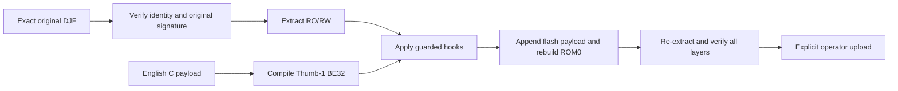

# Architecture

## Build and runtime flow

The supported source is MFC-J5720DW R2401191337:F58C. The profile records target
identity; runtime addresses are still encoded in `src/native_backend.c` and
`src/control_payload.c`. This is deliberately not a universal address abstraction.

The status renderer pointer at `0x406efc00` is redirected to a payload in the
ROM0 flash tail at `0x08e00000`. The original renderer still draws the native
status page; the payload adds the control panel. The payload requires no new
writable global segment or BSS initialization.

The near-source entry at `0x402a47e2` receives a checked Thumb veneer. The new
source samples/caches the original ADC value, then uses persisted total
consumption to select full/near when the cartridge and thresholds are valid.
During printer-resource blocking it keeps the current logical latch stable,
so an intermediate EEPROM write is not interpreted as a completed calibration.
Invalid indices, unavailable storage and invalid thresholds use conservative
native-source behavior.

## Actual counters and percentage calculation

Logical array order is **BK/Y/C/M**. Native physical sensor order is **BK/C/Y/M**.
These orders must not be interchanged.

| Color | Native color argument | Total storage ID, 5 bytes | Sensor storage ID, 4 bytes |
| --- | --- | --- | --- |
| Black | `0` | `60` | `3c` |
| Yellow | `11` | `6a` | `44` |
| Cyan | `12` | `65` | `40` |
| Magenta | `13` | `6f` | `48` |

Numbers in this table are hexadecimal. Totals are 64-bit in RAM and 40-bit in
persistent storage. Sensor counters are a separate 32-bit family. Native RAM
bases include `0x42354e00` for totals, `0x42354e88` for sensor counts and
`0x42354f58` for pending sensor usage. Fractional fields also need consistent
handling; clearing a main value alone can allow old pending usage to return.

The native status object is `0x00210078`; fields `81/82/83/84` feed the real
web bars. The handler `0x4033d1da` obtains percentages from `0x40457ad6`.
Define T from `0x40283b4a`, L from `0x40283dde`, and a history-dependent A.
For valid T>A, D=floor((T-A)/100). The normal branch uses approximately
floor((T-N)/D); the near branch uses floor((L-S)/D). Native helpers truncate
to a byte and clamp to 1..100. Separate state gates produce zero.

The calibration model uses the recovered piecewise calculation, not a generic
capacity percentage formula. The count-based transition N=T-L makes the two
branches continuous. Native first-cartridge history can change A, so partial
branch changes are rejected when their calibration would become unstable.

## Request and transaction boundaries

The handler requires native `AUTH_LOGIN`, POST, an HTTP Origin matching Host,
explicit confirmation, one color mask, and the prior total counter. Unknown
or duplicate fields, overlong/invalid encodings and stale values are rejected.
There is no web password embedded in the payload.

An existing object mutex serializes object clients. A native resource-3 busy
reference blocks normal printer starts during the transaction. The code checks
RAM/pending/fraction/state snapshots again before publishing under a short
non-nested task-dispatch-disable/enable section. EEPROM calls and waits occur
outside that bounded section. This does not prove exclusion of every possible
ISR or autonomous maintenance path.

The write transaction updates only selected fields, reads them back, publishes
RAM state, and asks the original percentage getter to verify the result. An
error triggers restoration attempts for storage and RAM. Restoration failure
is a distinct result. The operation is not power-loss atomic.

## Evidence boundaries

The original control build was reported working by its operator after the
read-only diagnostic version established real flash execution and POST/login
binding. English source restructuring was verified locally, not uploaded.
Full hardware restart/durability and long-running native transitions remain
separate tests. Local disassembler databases and raw device traces are private
research artifacts and are intentionally excluded from this source repository.
